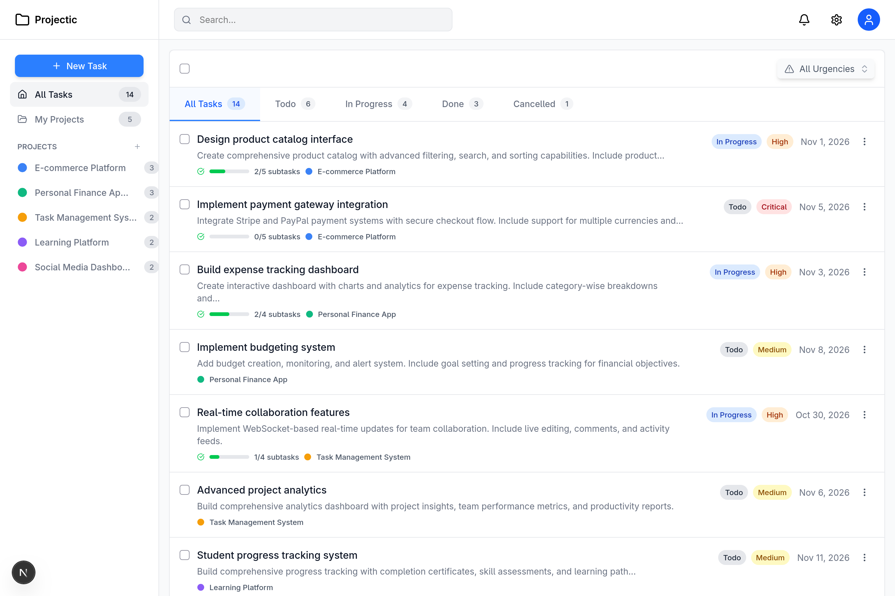
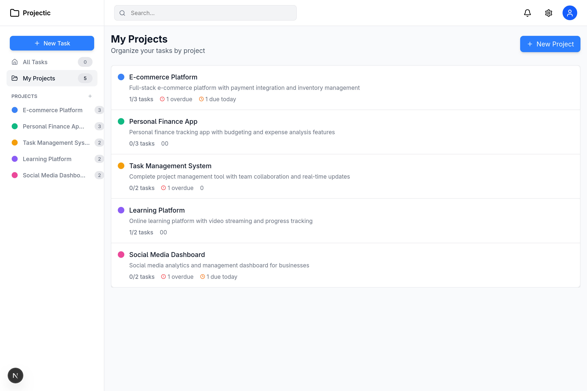
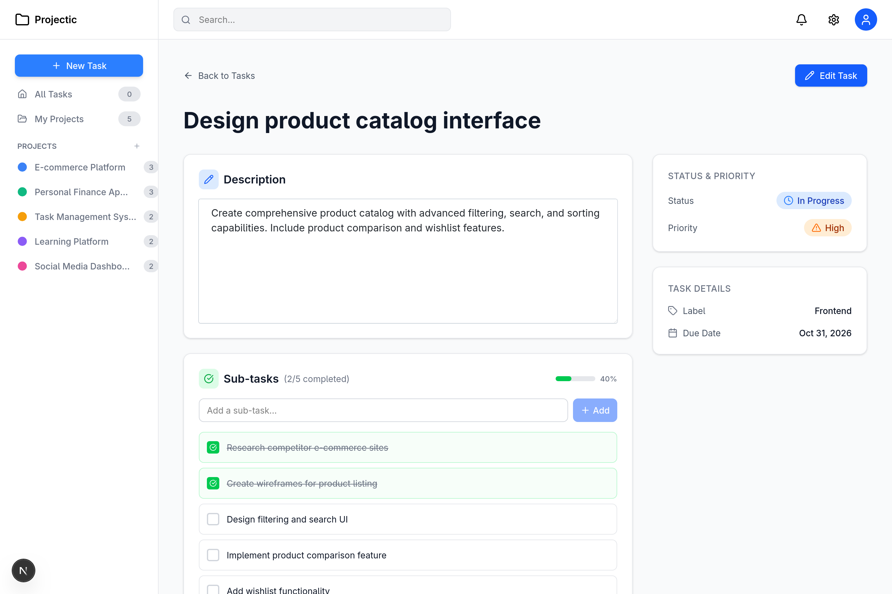

# Projectic

A modern, fast, and lightweight project & task management web application built with **Next.js 15**, **React 19**, **TypeScript**, **Drizzle ORM**, and **PGlite**.

[](LICENSE)

---

## Preview

<p align="center">
  
</p>

<p align="center">
  
  
</p>

---

## Features

- 📁 **Project Organization** — Group and organize tasks into dedicated projects with custom color tags.
- 📋 **Comprehensive Task Tracking** — Manage tasks with status flags (`Todo`, `In Progress`, `Done`, `Cancelled`), priority levels (`Low`, `Medium`, `High`, `Critical`), and due dates.
- ☑️ **Subtask Checklists** — Decompose complex work into manageable subtasks with automated progress bars.
- 📝 **Markdown Task Descriptions** — Support for rich-text markdown in task notes and details.
- 🔍 **Filtering & Progress Metrics** — Instant overview of overdue items, tasks due today, and completion rates.
- 🔒 **Built-in Authentication** — Secure credentials-based authentication with bcrypt and stateless JWT sessions.
- ⚡ **Zero-Config Embedded Database** — Powered by [PGlite](https://pglite.electric-sql.com/) (in-process PostgreSQL) for frictionless local development without needing external Docker or Postgres containers.

---

## Tech Stack

- **Framework**: [Next.js 15](https://nextjs.org/) (App Router)
- **UI & Styling**: [React 19](https://react.dev/), [Tailwind CSS 4](https://tailwindcss.com/), [Lucide React](https://lucide.dev/)
- **State Management**: [Zustand](https://github.com/pmndrs/zustand)
- **Database & ORM**: [Drizzle ORM](https://orm.drizzle.team/) with [PGlite](https://pglite.electric-sql.com/) / PostgreSQL
- **Validation & Forms**: [Zod](https://zod.dev/), [React Hook Form](https://react-hook-form.com/)
- **Type Safety**: [TypeScript](https://www.typescriptlang.org/) (Strict Mode)

---

## Getting Started

### Prerequisites

- **Node.js** >= 20
- **npm** (or `pnpm` / `yarn`)

### Installation

1. **Clone the repository:**
   ```bash
   git clone https://github.com/RaihanStark/projectic.git
   cd projectic
   ```

2. **Install dependencies:**
   ```bash
   npm install
   ```

3. **Configure environment variables:**
   ```bash
   cp .env.example .env
   ```

4. **Start the development server:**
   ```bash
   npm run dev
   ```

   The app will start at [http://localhost:3000](http://localhost:3000) with a local PGlite database running automatically in the background.

---

## Available Scripts

| Script | Description |
|---|---|
| `npm run dev` | Runs the local PGlite server and Next.js dev server concurrently |
| `npm run build` | Builds the Next.js application for production |
| `npm run start` | Starts the production server |
| `npm run check-types` | Type-checks the TypeScript codebase |
| `npm run lint` | Lints the codebase with ESLint |
| `npm run db:generate` | Generates Drizzle migration files |
| `npm run db:migrate` | Runs Drizzle database migrations |
| `npm run db:studio` | Opens Drizzle Studio to inspect and edit database records |

---

## License

This project is open-source and available under the [MIT License](LICENSE).
